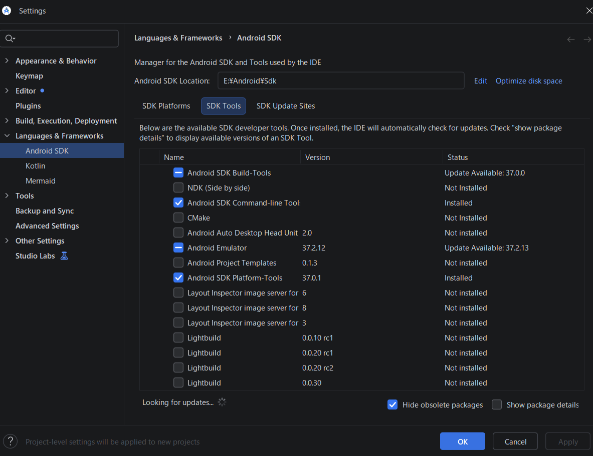
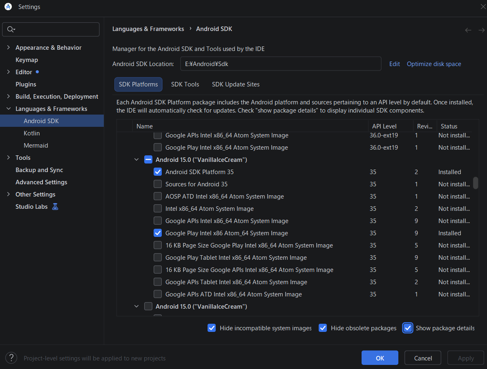

# 2. Android StudioとAVDを用意する

AVDは、Android端末をWindows上で動かす仮想端末です。リーダーアプリとGoogle Playを使うため、Google Playストア入りのシステムイメージを選びます。

> 🐘 **AVDはファイルが非常に大きく、動作も重くなります**: Android StudioとSDKで数GB、AVDのOSイメージ（Google Play入りのSystem Image）で数GB、AVD本体のデータ（ユーザーデータやスナップショット）で数GB〜十数GBを使い、合計で十数GB以上になります。AVDの起動中はメモリとCPUを多く使うため、PC全体の動作が重くなります。初回の起動や、PCの性能が低い場合は特に時間がかかります。メモリ16GB以上のPCと、SSDの十分な空き容量をおすすめします。使い終わったら、AVDを閉じてください。

> 💡 画面寸法や密度は、AVDを作るときに手で合わせる必要はありません。ebook2xtcで出力対象と倍率を選び、アプリからAVDを起動すると設定されます（[5章](05-launch-avd.md)）。

## Android StudioとSDKを入れる

1. [Android Studio公式インストール手順](https://developer.android.com/studio/install)から、Windows版を入手してインストールします。ebook2xtcの「取得」タブ最上部にある「Android環境の準備」→「Android Studioを入手（公式）」からも、同じページを開けます。準備完了後は「導入・再設定を開く」でボタンを再表示できます。初回のSetup Wizardでは「Install Type」に **Standard** を選びます。SDKのライセンスを確認・受諾し、ダウンロード完了まで待ってください。
2. Android StudioのWelcome画面に **New Project／Open／Clone Repository** が表示されても、どれも選びません。**More Actions → SDK Manager** を開きます。すでにSettings画面を開いている場合は **Languages & Frameworks → Android SDK** へ進みます。
3. **SDK Toolsタブ** を開き、次の **4項目** にチェック、または青い横棒が付いていることを確認します。

   - **Android SDK Build-Tools**（Android Studioの標準項目で、ebook2xtcは直接使用しません）
   - **Android Emulator**
   - **Android SDK Platform-Tools**
   - **Android SDK Command-line Tools (latest)**（**ebook2xtcでAVDを作成するために必須です**）

   未導入の項目があれば必ずチェックを入れ、**Apply** を押してライセンスを確認・受諾し、状態が **Installed** になるまで待ってください。チェックだけが付いていても「Not Installed」の間は導入が完了していません。Build-ToolsやEmulatorに青い横棒と「Update Available」が表示される場合は、導入済みで更新版があるという意味です。初回セットアップのために更新する必要はありません。

*図1：SDK Toolsタブの4項目。Build-ToolsとEmulatorの青い横棒は導入済みで更新版がある状態です。Command-line ToolsとPlatform-Toolsはチェック付きでInstalledです。*

> ✅ **ここで使うAndroidのバージョンは「Android 15.0（VanillaIceCream）／API 35」です。** Android Studioで新しいAndroid 16／17が先に表示されても、次の手順ではAndroid 15の行を選んでください。ほかのバージョンが導入済みの場合、残しておいてもかまいませんし、使わないならアンインストールしてもかまいません（ほかのAVDで使っているバージョンは残してください）。

4. **SDK Platformsタブ** を開き、一覧の **Android 15.0（VanillaIceCream）／API Level 35** を探します。**初回導入ではAndroid 15をインストールする操作が必要です。** Android 15の行の左側にある展開矢印をクリックし、右下の **Show package details** をオンにして、次の **2項目** のチェックボックスをクリックしてオンにします。

   - **Android SDK Platform 35**
   - **Google Play Intel x86_64 Atom System Image**

   **Apply**（または **OK**）を押し、確認画面でライセンスに同意して、ダウンロードとインストールが終わるまで待ちます。最後に、この2項目の状態が **Installed** になったことを確認します。すでに両方ともInstalledの場合だけ、インストール操作を省けます。**Google APIs** のイメージやAndroid 16／17のイメージでは代用できません。AVDのOSイメージは容量が大きいため、空き容量とネット接続を確認してください。

   > 💡 **Android 17の導入は任意です。** 初回のインストール画面でAndroid 17に最初からチェックが入っている場合、チェックを残して導入しても、外して導入を省いてもかまいません。残すと将来Android 17のAVDで動作を試せます。外すとダウンロード量とディスク使用量を減らせます。ただし、**Installedと表示されている項目のチェックを外すとアンインストール**になります。既存のAndroid 17のAVDを使う場合は、その項目を残してください。ebook2xtc用のAndroid 15の上記2項目は必ず導入します。

*図2：インストール後、Android 15／API 35の2項目がInstalledになった画面例です。初回は上の手順でAndroid 15の項目をクリックしてインストールしてください。画面例のSDK保存先はE:\Android\Sdkです。*

5. SDK Manager上部の **Android SDK Location** を控え、**OK** で閉じます。ebook2xtcの「取得」タブに戻り、「準備を再確認」を押します。アプリが、SDK・System Image・仮想化の状態を確かめます。
   - 仮想化に関する警告が出なければ、Windowsの機能を変更する必要はなく、このためのPC再起動も不要です。
   - 警告が出た場合は「後の手順でPCの再起動が必要です」と確認画面が出ます。**Windows PC本体の再起動が後で必要**になることを了承して準備を続ける場合は **OK** を押します。**キャンセル** すると標準環境のセットアップには進みません。Windowsの設定を変えるのは、AVDを初めて起動する前でかまいません。

   > 💡 仮想化の確認だけを早めに済ませたい場合は、手順3でAndroid Emulatorを入れた時点で「準備を再確認」を押してもかまいません。そのときはSystem Imageが未導入と表示されますが、手順4の後に押し直せば解消します。

6. 「標準環境をセットアップ」を押します。同じ設定のAVDがすでにある場合は「環境準備済み」と表示され、このボタンは押せません。そのAVDをそのまま使います。詳しくは[13章](13-migration.md)を参照してください。

7. **手順5で仮想化の警告が出たPCだけ**、AVDの初回起動前に「Windowsの機能を開く」から **「Windows ハイパーバイザー プラットフォーム」** を有効にします。Android Studioに「Enable Windows Hypervisor Platform」と表示された場合は、**Enable and Restart Now** でも進められます。作業を保存して **Windows PC本体を一度再起動**し、ebook2xtcの「準備を再確認」を押してください。ebook2xtcやAndroid Studioだけの再起動では反映されません。引き続き仮想化を利用できない場合は、PCのBIOS/UEFIでIntel VT-xまたはAMD SVMが有効か確認します（[Android公式の仮想化設定](https://developer.android.com/studio/run/emulator-acceleration)）。

> ⚠️ 仮想化診断で警告が出ても、実際には起動できる環境があります。③の「起動」を押した際の警告で「このまま起動を試す」を選ぶと、AVDの起動を試行できます。起動できなければ、上記のWindows設定とBIOS/UEFI設定を確認してください。

> 📦 **Command-line Toolsが必要な場面**: 「標準環境をセットアップ」と、環境プロファイルの読み込み（[13章](13-migration.md)）では、Command-line Toolsの `avdmanager` でAVDを作成します。

> ☕ **Javaの設定**: v0.2.3以降、ebook2xtcはAVD作成時にAndroid Studio付属のJava（JBR）を自動で探し、Java 17以上であればその実行にだけ使用します。通常はPowerShellでの設定や別のJDKの導入は不要です。Android Studioを標準以外の場所に入れた場合など、Javaが見つからなければ[13章の対処](13-migration.md)を確認してください。

## ebook2xtcがSDKを探す場所

ebook2xtcは、`ANDROID_HOME` または `ANDROID_SDK_ROOT`、標準のSDKフォルダーなどからSDKを探します。AVDが見つからない場合は、手順5で控えたSDKの場所に、`platform-tools\adb.exe` と `emulator\emulator.exe` があることを確認してください。

図1・図2のSDK保存先は一例です。利用者のPCではSDK Managerに表示された実際の場所を使ってください。複数のSDKがある場合、ebook2xtcは同梱JSONが要求する **Android 15／Google Play／x86_64** のSystem Imageを持つSDKを優先します。見つからない場合、エラーに確認したSDKの場所が表示されます。Android Studioの **Android SDK Location** と比べ、異なる場合は取得タブ最上部の「SDK保存先を指定（認識しない場合）」から、Android Studioに表示されたSDKのフォルダーを選んでください。選択先はポータブル版のiniに保存され、次回も使われます。PowerShellでの設定は不要です。

## Google Play対応のAVDを作る

> 🚀 **配布版ではAVDの手作業作成を省略できます**: ebook2xtcの初回起動時に、EXEと同じフォルダーの環境JSONを自動検出します。必要なSystem Imageを入れ、「取得」タブの「標準環境をセットアップ」を押してください（[13章](13-migration.md)）。この後の手作業でのAVD作成手順は不要です。日本語化とリーダーアプリの準備（[3章](03-japanese-and-reader.md)）はセットアップ後も必要です。

1. Android StudioのWelcome画面から「More Actions」→「Virtual Device Manager」を開きます。プロジェクトを開いている場合は、「View」→「Tool Windows」→「Device Manager」から開けます。
2. 「Create Device」を押し、Phoneカテゴリから電話型のハードウェアプロファイルを選びます。特定のPixel機種を完全に再現する必要はありません。
3. System Imageの一覧で **Android 15.0／API 35** の行を明示的に選びます。Android 16／17が初期選択されていたらAndroid 15へ切り替えてください。**Google Playのアイコンまたは表示が付いたイメージ**を選び、「Download」→「Next」へ進みます。Google APIsだけのイメージには、Playストアが入らない場合があります。
4. AVD名を付けます（例：`S4Capture_API35_Play`）。初期画面の解像度とDPIは既定値のままでかまいません。
5. 「Show Advanced Settings」を開き、「Keyboard」→「Enable Keyboard Input（キーボード入力を有効にする）」を有効にします。PCのキーボードでGoogle／リーダーアプリのログイン欄へ入力するときに使います（[4章](04-keyboard-and-sleep.md)）。設定を確認して「Finish」を押します。
6. 仮想化の警告が出ている場合は、上の手順7を済ませます。警告がなければPC再起動は不要です。Device Managerで、作成したAVDを一度起動します。初回の起動には時間がかかることがあります。Androidの初期画面が出たら、セットアップを完了してください。

AVDの作成手順は、[Android DevelopersのAVDガイド](https://developer.android.com/studio/run/managing-avds)も参照してください。
